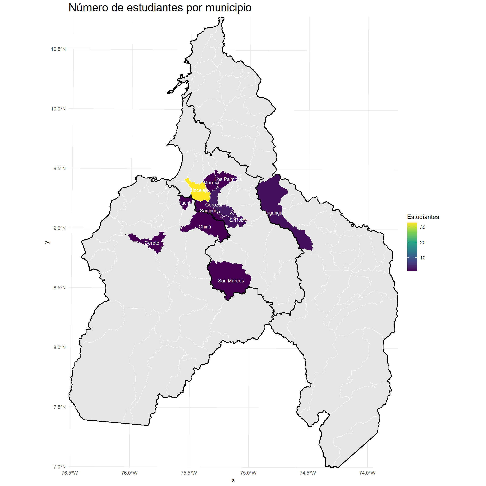

# Análisis exploratorio de la sensibilidad intercultural {#eda}

Aquí realizaremos el análisis exploratorio de los datos del pretest y postest con los grupos de control y experimental.

## Análisis exploratorio de las variables sociodemográficas

```{r sociodemo}
var_comunidad <- "¿Te identificas como miembro de una comunidad indígena, afrodescendiente, raizal, palenquero o Rom?"
n_lugar <- table(pre$Lugar)
sociodemo <- frecuencias(
  pre,
  c("Edad" = "Q3", "Estrato socioeconómico" = "Q5",
    "Lugar donde has vivido la mayor parte de tu vida" = "Lugar", "Sexo" = "Q4") %>%
    c(setNames("Q7", var_comunidad)),
  niveles = list("Edad" = c("15-17 años", "18-21 años", "Más de 22 años"),
                 "Estrato socioeconómico" = paste("Estrato", 1:4),
                 "Lugar donde has vivido la mayor parte de tu vida" =
                   names(n_lugar)[order(-n_lugar, names(n_lugar))],
                 "Sexo" = c("Femenino", "Masculino"),
                 setNames(list(c("No", "Si")), var_comunidad))
)
tabla_frecuencias(sociodemo, "Distribución de variables sociodemográficas (n y %)", categoria = "Categoría")
```

```{r grafsociodemo}
sociodemo %>%
  filter(Variable != "Lugar donde has vivido la mayor parte de tu vida") %>%
  grafico_frecuencias(c(var_comunidad, "Edad", "Estrato socioeconómico", "Sexo"),
                      "Número de estudiantes (%)")
```

### Mapa

Este es el mapa del número de estudiantes por municipio.

```{r mapa, out.width="1152px"}
# Figura original: la cartografía municipal usada (DANE) no está disponible en el proyecto.

```

Podemos ver que el número de estudiantes se concentra en el municipio de Sincelejo, seguido de Corozal.

## Analisis de las variables del perfil académico

Realicemos el análisis exploratorio del perfil académico y la competencia lingüistica donde los estudiantes tienen nivel de avance académico intermedio

```{r perfilacaycl}
var_lengua <- "Aparte de ingles y frances, estas estudiando o has estudiado otra lengua?"
var_ingles <- "Que nivel de ingles consideras que tienes?"
idiomas <- frecuencias(pre, setNames(c("Q9", "Q8"), c(var_lengua, var_ingles)),
                       niveles = setNames(list(c("Si", "No"), c("A2", "B1", "B2", "C1")),
                                          c(var_lengua, var_ingles)))
tabla_frecuencias(idiomas, "Distribucion de variables de idiomas (n y %)")
```

```{r graficoperfilycl}
idiomas %>%
  group_by(Variable) %>%
  arrange(desc(n), .by_group = TRUE) %>%
  ungroup() %>%
  grafico_frecuencias(c(var_lengua, var_ingles), "Numero de estudiantes (%)")
```

## Análisis de las variables de consumo cultural externo y proyección intercultural

Ahora, hagamos el análisis exploratorio del concumo cultural externo y la proyección intercultural

```{r grafcultural}
frecuencia <- c("Todos los dias", "Casi todos los dias", "Ocasionalmente", "Casi nunca", "Nunca")
var_entret <- "Frecuencia consumo cultural (entretenimiento)"
var_medios <- "Frecuencia consumo cultural (medios)"
var_mudarse <- "¿has contemplado mudarte de forma definitiva a un país cuya cultura o lengua consideras distinta a la tuya?"
cultural <- frecuencias(pre, setNames(c("Q11", "Q10", "Q12"), c(var_entret, var_medios, var_mudarse)),
                        niveles = setNames(list(frecuencia, frecuencia, c("Si", "No")),
                                           c(var_entret, var_medios, var_mudarse)))
tabla_frecuencias(cultural, "Distribucion de variables de consumo cultural y movilidad (n y %)")
```

```{r grafcultural-graf}
grafico_frecuencias(cultural, c(var_mudarse, var_entret, var_medios), "Numero de estudiantes (%)")
```
